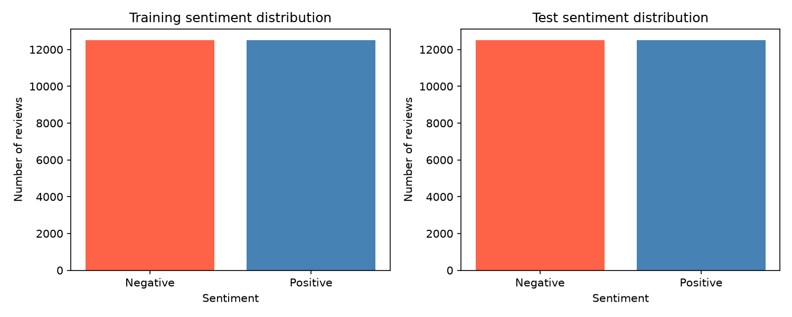
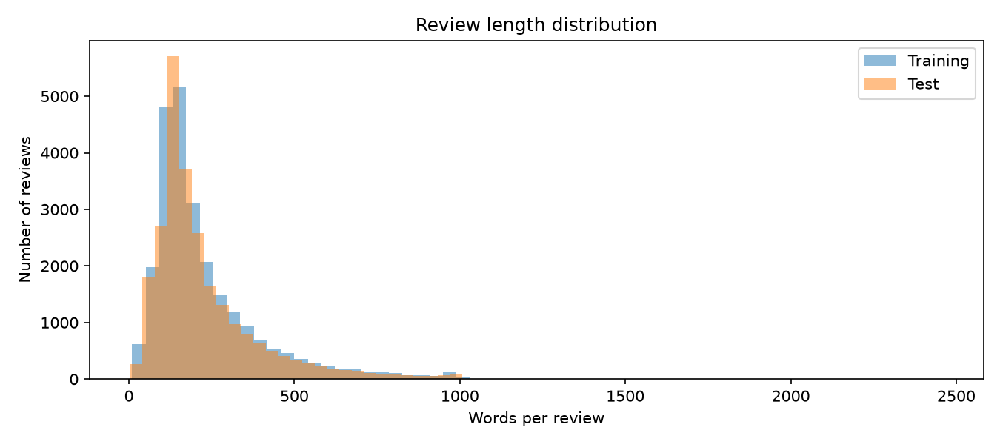
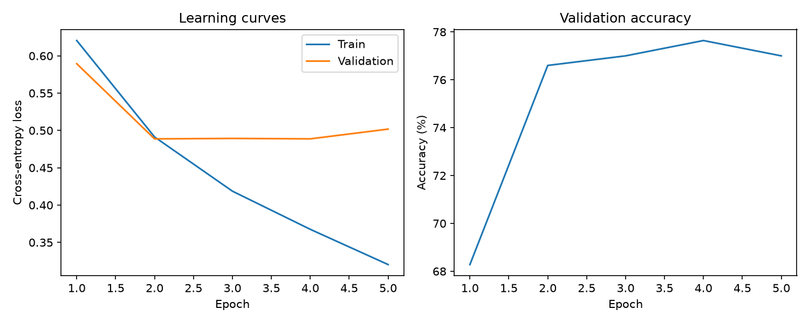

# Transformer Sentiment Analysis

SentimentScope classifies IMDB movie reviews as positive or negative using a custom
PyTorch transformer trained from scratch. This project completes the Udacity
SentimentScope starter, preserving its `DemoGPT` attention and transformer blocks.
BERT supplies the subword tokenizer; pretrained BERT model weights are not used.

## Results

| Metric | Result |
| --- | ---: |
| Training reviews | 22,500 |
| Validation reviews | 2,500 |
| Held-out test reviews | 25,000 |
| Selected checkpoint epoch | 2 |
| Selected checkpoint validation accuracy | 76.60% |
| Test accuracy | **75.352%** (75.35% rounded) |
| Test cross-entropy loss | 0.4928 |
| Required test accuracy | >75% — met |

Training ran locally on Apple Silicon through PyTorch MPS. Five epochs completed;
early stopping restored epoch 2, which had the lowest validation loss. Epoch 4
had higher validation accuracy (77.64%), but checkpoint selection used loss.
The notebook retains the actual executed outputs.

## Approach

- Load labeled reviews from the original IMDB archive with a helper function;
  clean HTML and normalize whitespace while preserving punctuation and negation.
- Explore sentiment counts and review lengths with descriptive statistics and
  labeled visualizations. Split the official training set 90/10 with stratification.
- Tokenize using `bert-base-uncased`, right-padding/truncating to 128 tokens.
- Use a custom `IMDBDataset` and PyTorch DataLoaders, shuffling training reviews.
- Train a four-layer causal transformer: 128-dimensional embeddings, four heads,
  32 dimensions per head, dropout 0.1, and a two-class linear head.
- Mean-pool non-padding embeddings. Train on raw logits with cross-entropy;
  apply softmax only when returning prediction probabilities.
- Optimize with AdamW (learning rate 0.0003, weight decay 0.01), batch size 32,
  gradient clipping at 1.0, a ten-epoch budget, and early-stopping patience of three.
  Validation loss chooses the saved checkpoint before final test evaluation.

## Run the project

1. Follow [SETUP.md](SETUP.md) to create an environment and select the notebook kernel.
2. Obtain `aclImdb_v1.tar.gz` from the course workspace or the
   [original Stanford dataset page](https://ai.stanford.edu/~amaas/data/sentiment/),
   and place it in `starter/`. The archive and extracted reviews are excluded from Git.
3. Open [the executed notebook](starter/SentimentScope_starter.ipynb).
   Saved outputs can be reviewed without rerunning training. To reproduce the experiment,
   run its cells in order. CUDA, MPS, and CPU device selection is supported.
4. Review the [results report](starter/artifacts/results_report.txt),
   [epoch history](starter/artifacts/history.json), and
   [test metrics](starter/artifacts/test_metrics.json).

The tokenizer requires internet on its first download during training. Runtime versions
from the completed local run are recorded in [environment-freeze.txt](environment-freeze.txt).
`requirements.txt` supplies portable dependency ranges, rather than exact CUDA wheels.
Seeds are set to 42; results may vary across devices, library versions, and cell execution order.
Rerunning the training cell initializes a new model and overwrites saved training artifacts.

## Saved checkpoint and batch inference

The repository includes `starter/artifacts/best_model.pt` and the tokenizer directory.
The final notebook section defines `SentimentPredictor`, loads those saved files, and
returns a sentiment label and both class probabilities for each input in a batch:

```python
predictor = SentimentPredictor(ARTIFACT_DIR, device=device)
predictor.predict([
    "An engaging and beautifully acted film.",
    "A tedious movie with a weak script.",
])
```

In a fresh kernel, execute the imports, `clean_review`, and the model class definitions
before the inference section. Training and dataset extraction are not required for
inference; define `ARTIFACT_DIR` as the path to the included artifacts directory.
The checkpoint stores model weights and configuration, not optimizer state.

## Visualizations





## Key takeaways and limitations

1. Padding-aware pooling converts token representations into a review-level feature
   vector without letting padded positions dominate the classifier.
2. Training loss continued to decline while validation loss plateaued, demonstrating
   overfitting and the value of restoring a validation-selected checkpoint.
3. The 128-token limit discards information in long reviews. A longer context or
   model changes could be explored using validation data, but >90% accuracy has not
   been demonstrated. Output probabilities have not been calibrated.

The reported score is a passing baseline on IMDB, not evidence of production readiness
or improved recommendation engagement. Two demonstration predictions check the batch
interface; overall effectiveness is assessed on the held-out test set.

## Attribution

Based on the [Udacity transformer project starter](https://github.com/udacity/cd13905-transformers-project-starter).
The original [LICENSE.txt](LICENSE.txt) is retained. The original IMDB dataset is
credited to Andrew L. Maas and collaborators; see the Stanford dataset page above.
